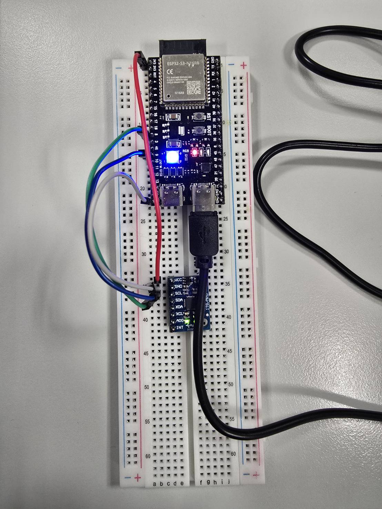

# Real-Time AI Breathing & Motion Monitor on ESP32-S3

**Course:** Computer-Aided Medical Diagnostics (MPA-PRM)  
**Lab:** Application IV: Real-time AI applications  
**Institution:** Brno University of Technology (BUT)  

---

## 👥 Team Members
- **Sing-Yu Lin**
- **Maxime Brière**

- **Project Repository:** [https://github.com/Singyu514/esp32-breathing-monitor](https://github.com/Singyu514/esp32-breathing-monitor)
- **Live BLE Monitoring Station (GitHub Pages):** [https://singyu514.github.io/esp32-breathing-monitor/](https://singyu514.github.io/esp32-breathing-monitor/) *(Deployment in progress)*

---

## 🎯 Project Overview
This project builds a real-time patient monitoring device on an **ESP32-S3 N16R8** development board connected to an **MPU-6050 (GY-521)** 6-DOF IMU (accelerometer & gyroscope).

The device autonomously classifies 4 distinct physical and respiratory states directly on the microcontroller without sending data to an external computer for inference:

| State | Physical Condition | Board RGB LED |
| :--- | :--- | :--- |
| **Calm breathing** | Sensor placed against chest, regular resting respiration | 🟢 **Green** |
| **Fast breathing** | Sensor placed against chest, rapid / tachypneic respiration | 🔴 **Red** |
| **Not attached** | Device held in hand, moved slowly, or resting on a table | 🔵 **Blue** |
| **Shaking** | Device being shaken vigorously | 🟣 **Magenta** |

---

## 🔌 Hardware Setup & Wiring

### Components:
- **Microcontroller:** ESP32-S3 N16R8 DevKit
- **Sensor:** MPU-6050 (GY-521) 3-axis Accelerometer + 3-axis Gyroscope
- **Indicator:** On-board addressable RGB LED (WS2812 / NeoPixel)
- **Connections:** Breadboard & jumper wires, powered via USB cable

### Pinout (I2C):
| MPU-6050 Pin | ESP32-S3 Pin | Description |
| :--- | :--- | :--- |
| **VCC** | `3V3` / `5V` | Power supply |
| **GND** | `GND` | Ground |
| **SCL** | `GPIO 9` *(default)* | I2C Clock |
| **SDA** | `GPIO 8` *(default)* | I2C Data |
| **AD0** | `GND` | I2C address selection (`0x68`) |

### Hardware Wiring Photo

---

## 📊 Project Progress & Grading Milestones

- [x] **Repository & Project Setup** (Compulsory)
  - [x] Git repository created on branch `main`
  - [x] README and structure initialized
  - [ ] Shared with teacher (`tomasvicar`)
- [x] **Part 1: Movement vs. Shaking (2.5 pts)** - *Validated by teacher*
  - [x] Omnidirectional sensor reading over I2C (SDA: 8, SCL: 9) at 50 Hz
  - [x] Rolling window differential energy metric (`d_acc + 0.5 * d_gyr`)
  - [x] Real-time RGB LED feedback (Blue = Slow movement / Still, Magenta = Shaking)
- [x] **Part 2: Breathing Classification (2.5 pts)** - *Validated on board (98% accuracy)*
  - [x] Data collection across 16 sessions (calm, fast, lying still, moving in hand, shaking)
  - [x] Feature extraction: 6 spatial & dynamic IMU metrics with rotation awareness
  - [x] Embedded C++ Random Forest inference (8 trees, depth 5) + rolling majority smoothing filter
  - [x] Real-time RGB LED feedback: Green (calm), Red (fast), Blue (not attached), Magenta (shaking)
- [x] **Part 3: BLE Bedside Monitor (1.5 pts)** - *Ready & deployed*
  - [x] BLE GATT Service & State Characteristic notification on ESP32-S3 (`ESP32_Breathing_Monitor`)
  - [x] Web Bluetooth monitoring dashboard on GitHub Pages (full English clinical UI)
  - [x] Real-time state timeline visualization
  - [x] Configurable duration alarms (Tachypnea > 8s, Detached > 10s) with audio beeper
  - [x] Instantaneous connection-lost alarm with critical siren
- [x] **Part 4: Web Page from the Board (1.0 pt)** - *Ready to show*
  - [x] ESP32-S3 Wi-Fi SoftAP hotspot (`ESP32_Breathing_Monitor`)
  - [x] Standalone HTTP web server running on chip (`http://192.168.4.1`)
  - [x] Live acceleration signal waveform oscilloscope (pure Canvas, zero external dependencies)
  - [x] Real-time prediction state badge and all 4 class probability confidence bars
- [x] **Part 5: Own Extension (1.5 pts)** - *Completed & demonstrated*
  - [x] Medical sleep position classifier: Supine (Back), Prone (Stomach), Left Lateral, Right Lateral, Upright
  - [x] Low-pass gravitational vector isolation ($\alpha = 0.05$)
  - [x] Overnight event logger ("Log of the Night") storing transitions with timestamps & durations
  - [x] Live clinical Wi-Fi dashboard with Positional Obstructive Sleep Apnea (POSA) alert banner
  - [x] RGB LED indicator: Blue (Back), Red (Stomach), Green (Left side), Yellow (Right side), White (Upright)
- [x] **Part 6: Documentation & Reproducibility (1.0 pt)** - *Complete*
  - [x] All team members named (Sing-Yu Lin & Maxime Brière)
  - [x] Repository shared with teacher (`tomasvicar`)
  - [x] Live BLE monitoring page linked (GitHub Pages)
  - [x] Full build, flash, and ML pipeline documentation
  - [x] BUT AI tools declaration included

---

## 🧠 Machine Learning Pipeline
1. **Data Acquisition:** Sampling accelerometer & gyroscope axes at 50 Hz via I2C (`SAMPLE_INTERVAL_MS = 20`).
2. **Windowing & Preprocessing:** Sliding window of 150 samples (3.0 seconds) with 25-sample step size (0.5s refresh, 83% overlap).
3. **Engineered Features (6 spatial & dynamic metrics):**
   - $a_{\text{norm}}$: Orientation-invariant acceleration magnitude.
   - `log_acc_var`: Log-transformed variance separating still table noise from breathing oscillations and shocks.
   - `acc_p2p`: Peak-to-peak amplitude directly capturing physical thoracic chest expansion.
   - `gyr_mean`: Mean angular velocity. Critical biomechanical discriminant: chest respiration has constrained rotation ($< 8^\circ/\text{s}$), whereas unattached hand manipulation generates continuous wrist rotation ($> 15^\circ/\text{s}$).
   - `log_gyr_mean`: Log scale angular velocity.
   - `zero_crossings`: Sign changes of mean-centered $a_{\text{norm}}$, acting as a frugal respiratory frequency proxy.
   - `mean_abs_diff`: Discrete derivative energy isolating violent shakes.
4. **Classifier:** Random Forest (8 shallow trees, `max_depth = 5`) trained with `scikit-learn` on 16 recorded sessions (416 windows).
5. **On-Chip Pure C Inference:** Model trees transpiled to pure C `if/else` logic in `model.h`. Inference executes in $< 5 \ \mu\text{s}$ without TensorFlow Lite runtime dependencies.
6. **Decision Smoothing:** Rolling majority vote filter over 5 consecutive windows (2.5 seconds).

---

## 🛌 Own Extension: Sleep Position Monitor & Night Log
- **Clinical Motivation:** In Positional Obstructive Sleep Apnea (POSA), airway collapsibility increases significantly in the **Supine (back)** position due to gravitational tongue displacement.
- **Physical Isolation:** Steady gravity vector isolated using an exponential low-pass filter ($\vec{g}_{t} = (1-\alpha)\vec{g}_{t-1} + \alpha \vec{a}_t$, $\alpha = 0.05$).
- **Positions Recognized:**
  - 🔵 **On the Back (Supine):** $a_z > 0$, $|a_z| \ge |a_x|$ (Blue LED)
  - 🔴 **On the Stomach (Prone):** $a_z < 0$, $|a_z| \ge |a_x|$ (Red LED)
  - 🟢 **On the Left Side:** $a_x > 0$, $|a_x| > |a_z|$ (Green LED)
  - 🟡 **On the Right Side:** $a_x < 0$, $|a_x| > |a_z|$ (Yellow LED)
  - ⚪ **Upright / Sitting:** $|a_y| > 0.65g$ (White LED)
- **Overnight Event Log ("Log of the Night"):** An embedded circular event buffer records every position transition with its start timestamp and duration. The cumulative time and percentage spent in each posture are continuously calculated.
- **Interactive Web Dashboard:** The ESP32 serves a dedicated standalone web page over Wi-Fi (`ESP32_Sleep_Monitor` at `http://192.168.4.1`) displaying:
  - Real-time patient posture badge.
  - POSA warning banner if the patient stays on their back $> 15\,\text{s}$.
  - Posture time distribution bars.
  - Interactive table of the night log showing every historical transition.

---

## 🤖 AI Tools Declaration
In compliance with Brno University of Technology (BUT) guidelines:
- **AI Tool Used:** Google Antigravity / Gemini 3.8 assistant.
- **Scope of Use:** Initial project scaffolding, documentation structure, assistance with firmware skeleton (I2C/BLE/Wi-Fi), signal processing and feature engineering recipes, and Web Bluetooth API boilerplate. All code, data collection, and physical validation on the board are understood, checked, and run by the team members.

---

## 🚀 How to Run & Rebuild

### 1. Requirements
- Arduino IDE 2.x or PlatformIO
- Python 3.10+ (for model training: `numpy`, `scipy`, `scikit-learn`, `matplotlib`, `pandas`)
- Chrome / Edge with Web Bluetooth enabled (for BLE bedside monitor)

### 2. Microcontroller Firmware
1. Open the project firmware in Arduino IDE or VS Code PlatformIO.
2. Select board **ESP32S3 Dev Module** with appropriate partition scheme and USB CDC on boot enabled.
3. Flash the firmware onto the ESP32-S3.
4. Unplug and replug or power via standalone USB power supply.
